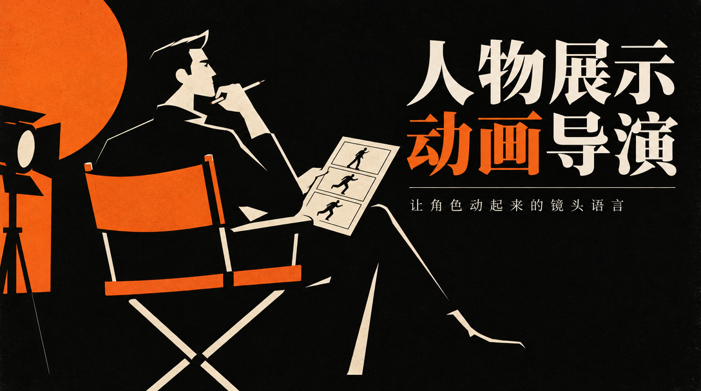

# domn-film-character-showcase



> 给 AI 视频写「角色展示/英雄亮相」分镜提示词，让陌生观众几秒内记住「这个人是谁、凭什么被记住」。

## 真实产出样例

下面是这个技能**实际会产出**的东西（抽自仓库内的 references/ 真实交付样例），不是抽象描述：

```text
③ 时长预算：
S0 局部 1.5s | 雪地上落着一只纸鹤            (G2 局部先行)
S1 登场 2.5s | 白衣剑客背对镜头立于风雪      (G1 剪影入场)
S2 展示 3.5s | 拔刀一闪，纸鹤炸成数百只绕身  (G5 轨迹留光+G4 慢动作)
S3 定格 2.5s | 收刀入鞘，抬头看镜头说台词    (G9 破第四面墙+G10 收势)
C2 逐镜提示词(中)：白衣黑发剑客侧身拔刀，一道白色光弧横扫，纸鹤炸开成
  数百只绕身高速盘旋化为流光；收刀入鞘，微微抬头直视镜头，开口说台词，
  口型同步；画面内不出现任何文字与字幕。
```

## 是什么

给 AI 视频写「角色展示/英雄亮相」分镜提示词，让陌生观众几秒内记住「这个人是谁、凭什么被记住」。 本仓库是一个 Agent 技能（SKILL.md 为唯一权威定义），把上面的方法论沉淀为可被对话触发的可执行流程。

## 为什么不同

与打戏相反——主体是单个角色向观众证明自己，推进力是信息释放而非接触；裁判是「记住脸>能力>性格>帅」，立 H10 全程无字幕、H11 画风随用户角色而定两条特异铁律。

## 怎么做（工作流）

<p align="center">
  
</p>

> 记住脸 > 能力 > 性格 > 帅；第四面墙只破一次

1. **读取画风** — 沿用用户角色已定的视觉风格，不自选
2. **抽八项档案** — 身份/动机/能力/弱点/标志/口吻/声音/关系
3. **定展示原型** — 选悬念/登场/揭密/签名之一
4. **排四拍** — S0 局部 → S1 登场 → S2 展示 → S3 签名
5. **落台词声音** — 写收势台词 + 质检三锚点一致性

## 怎么用

将本仓库放入支持 `SKILL.md` 的 Agent 技能目录：

- **WorkBuddy**：`~/.workbuddy/skills/domn-film-character-showcase/`
- **Codex / 其他**：对应 skills 目录

然后在对话中触发，例如：

```
用 domn-film-character-showcase 给这个白鸦剑客做 10 秒英雄亮相，要求第四面墙收势。
```

## 依赖

纯提示词方法论 + references/ 弹药库；涉及出图/视频时依赖外部图像生成或文生视频模型。

## 仓库结构

```
domn-film-character-showcase/
├── SKILL.md                 # 技能定义（唯一权威）
├── assets/                  # 模板 / 占位素材
├── references/              # 方法论弹药库
└── assets/readme/           # 本 README 的视觉资产（hero.webp / workflow.svg）
```

## 许可

本仓库内容以 `SKILL.md` 为唯一权威定义。如附带 `LICENSE` 文件，以其为准。

---

*README 由 `beautify-github-readme` 生成 · 封面图来自作者作品集，强调色由封面采样派生；工作流图为每技能独立 motif。*